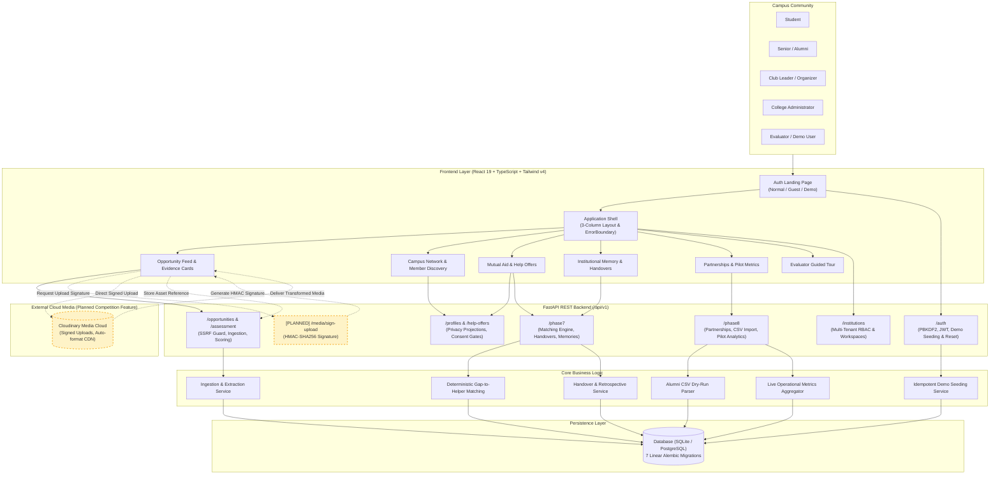

# EventSignal

**Evidence Before You Register. Connections Grounded in Purpose.**

EventSignal is an intelligent campus opportunity discovery and purpose-driven networking platform connecting students, seniors, alumni, faculty, and student organizations.

Built for **Hacktober HackDays 2026 — SheBuilds, Tech for Social Good**, continuing from its original foundation developed for **HackShift — Cmd+Shift+Create 2026** at IIIT Delhi (Team NeuroIgniter).

> **"AI extracts. Rules evaluate. Evidence explains. Students decide."**

- **Authoritative Product Specification:** [`docs/MVP_SPEC.md`](docs/MVP_SPEC.md)
- **Competition Implementation Record:** [`docs/HACKTOBER_HACKDAYS_2026.md`](docs/HACKTOBER_HACKDAYS_2026.md)
- **Comprehensive Quality Audit Report:** [`docs/FINAL_AUDIT_REPORT.md`](docs/FINAL_AUDIT_REPORT.md)
- **Demo Mode Verification Report:** [`docs/DEMO_MODE_AUDIT_REPORT.md`](docs/DEMO_MODE_AUDIT_REPORT.md)

---

## 1. Project Title & Tagline

**EventSignal**  
*Evidence Before You Register. Connections Grounded in Purpose.*

---

## 2. Competition & Project Overview

EventSignal is developed for the **SheBuilds — Tech for Social Good** track of **Hacktober HackDays 2026**.

The project originated at **HackShift — Cmd+Shift+Create 2026** under the theme *Alumni Network & Professional Connections: Building a Network, Not a Directory*. In this repository, EventSignal’s foundation has been audited, documented, and aligned with the civic and educational mission of **Tech for Social Good**: democratizing opportunity discovery, facilitating purpose-driven mutual aid, and preserving institutional knowledge across student generations.

---

## 3. Problem Statement

Modern college ecosystems face critical structural inequalities in student opportunity and professional growth:

1. **Information Inequality in Opportunity Discovery:** Valuable hackathons, research fellowships, startup grants, and specialized internships are scattered across chaotic messaging channels (WhatsApp, Telegram, Discord), unindexed departmental sites, and informal peer networks. Students outside privileged social circles miss crucial deadlines or invest effort into unverified, low-credibility events.
2. **Superficial, Directory-Style Networking:** Traditional college alumni portals resemble static phone books. Students resort to cold, uncontextualized outreach with dismal response rates, while alumni face broad, unfocused requests that ignore their availability and domain expertise.
3. **Institutional Amnesia (Campus Brain Drain):** Student societies, technical chapters, and organizing committees experience organizational memory loss every 1–2 years as senior cohorts graduate. Event retrospectives, vendor contacts, sponsor relationships, and leadership handover notes vanish, forcing incoming student leaders to rebuild from scratch.

---

## 4. Target Users & Social Impact

### 4.1 Target Users
- **Students:** Seeking credible, evidence-backed hackathons, fellowships, and internships, and requesting purpose-specific guidance from compatible mentors.
- **Seniors & Alumni Mentors:** Sharing domain expertise, publishing structured help offers, and setting explicit availability and consent thresholds.
- **Campus Club Leaders & Organizers:** Managing student organizations, conducting transparent leadership handovers, and preserving post-event lessons.
- **Faculty & College Administrators:** Overseeing multi-tenant campus workspaces, appointing official student positions, and reviewing verified pilot metrics.
- **Corporate & Community Partners:** Sponsoring student initiatives through transparent prospectuses and cross-college campaigns with conspicuous disclosure.
- **Hackathon Judges & Evaluators:** Exploring the platform using an isolated presentation environment (**Demo Mode**) pre-populated with an interconnected synthetic college community.

### 4.2 Social Impact
EventSignal acts as an equalizer for campus communities:
- **Democratizes Access:** Leveling the playing field so every student, regardless of existing social network or seniority, can access verified opportunities.
- **Protects Student Time & Trust:** Field-level evidence provenance (`FieldEvidence`) prevents students from falling victim to misleading opportunity claims.
- **Promotes Purposeful Mentorship:** Eliminating spam and cold outreach by routing requests only to mentors who have explicitly consented and match declared learning gaps.
- **Builds Long-Term Civic Capital:** Retaining institutional experience on campus, transforming student leadership from an ephemeral cycle into an enduring institutional asset.

---

## 5. Proposed Solution & Core Features

EventSignal structures campus interaction around a 3-pillar workflow:

$$\textbf{Discover} \longrightarrow \textbf{Connect} \longrightarrow \textbf{Preserve}$$

### Core Features:

1. **Opportunity Discovery (Discover):**
   - **Secure Public URL Ingestion:** Streamlined intake with robust Server-Side Request Forgery (SSRF) protection, port allowlists (80/443), and private IP blocking.
   - **Generic 3-Stage Extraction:** Multi-stage content extraction across JSON-LD structured data, OpenGraph tags, and semantic heuristic trees.
   - **Field-Level Provenance (`FieldEvidence`):** Distinguishes extraction outcomes (`FOUND`, `NOT_FOUND`, `SOURCES_DISAGREE`, `EXTRACTION_FAILED`).
   - **Deterministic Deduplication:** Canonical URL normalization prevents duplicate listings while supporting administrative refresh.
   - **Declarative Evidence Assessment:** Policy-driven scoring of completeness, evidence tiers (High, Moderate, Speculative), and source conflict tracking.

2. **Gap-to-Helper Engine (Connect):**
   - **Student Need Declaration:** Students articulate specific challenges, required skills, urgency, and privacy scope.
   - **Deterministic Matching Engine:** Rule-based compatibility scoring pairing student needs with active help offers and alumni expertise.
   - **Grounded Match Explanations (`MatchExplanation`):** Transparent rationales explaining domain overlap, skill synergy, and availability.
   - **Explicit Help Offers (`HelpOffer`):** Mentors publish structured offers with defined delivery modes and monthly capacities.
   - **Consent-Gated Connection Routing:** Enforces `willing_to_connect = true` and monthly connection caps before requests can be routed.

3. **EventSignal Legacy (Preserve):**
   - **Leadership Handovers (`LegacyHandover`):** Multi-stage transition records (`draft`, `submitted`, `acknowledged`, `superseded`) from outgoing to incoming club officers.
   - **Institutional Event Memories (`EventMemory`):** Retrospectives capturing achievements, operational mistakes, vendor contacts, and institutional lessons.
   - **Follow-up Commitments (`FollowUpTask`):** Accountable post-event tasks with priority levels and permanent completion locking.

4. **Institutional Workspace & Pilot Suite:**
   - Multi-tenant college workspaces with Role-Based Access Control (`PLATFORM_ADMIN`, `INSTITUTION_ADMIN`, `MEMBER`).
   - Verified partner directory, tiered sponsorship prospectuses, and cross-college campaigns with mandatory "Featured — Sponsored" disclosures.
   - Pre-commit dry-run CSV alumni directory import with zero default consent.
   - Measurable operational pilot metrics calculated from persisted records.

---

## 6. Key Differentiators

| Traditional Campus Portals | EventSignal Platform |
| :--- | :--- |
| **Static Directory of Names:** Unfiltered lists encouraging blind cold messaging. | **Purpose-Grounded Matching:** Needs-based Gap-to-Helper engine pairing specific student gaps with consented mentors. |
| **Unverified Opportunity Bulletins:** Promotional text accepted without validation. | **Evidence Before You Register:** Field-level extraction provenance (`FieldEvidence`) exposing missing or conflicting data. |
| **Black-Box AI Recommendations:** Opaque suggestions with no explainability. | **Deterministic, Explainable Rules:** Human-auditable scoring breakdowns explaining every match rationale. |
| **Annual Institutional Memory Wipeout:** Information lost when club leaders graduate. | **EventSignal Legacy:** Structured handovers, event retrospectives, and follow-up commitments preserved across cohorts. |
| **Unregulated Outreach:** Mentors inundated with random connection requests. | **Consent & Availability Gates:** Outreach strictly requires `willing_to_connect = true` and respects monthly capacity limits. |

---

## 7. Actual Technology Stack

The stack is strictly aligned with the codebase manifests (`backend/requirements.txt`, `frontend/package.json`):

### Backend
- **Framework:** FastAPI `0.143.3` (ASGI web framework)
- **Language / Runtime:** Python `3.12+` (Verified on Python `3.14.2`)
- **Server:** Uvicorn `0.54.0` (standard worker)
- **Validation & Settings:** Pydantic `2.14.1` & Pydantic-Settings `2.16.0`
- **Email Validation:** email-validator `2.2.0`
- **ORM & Database Toolkit:** SQLAlchemy `2.1.4` (DeclarativeBase, 2.0-style queries)
- **Schema Migrations:** Alembic `1.16.1` (7 linear migration scripts)
- **HTTP Client & Parsing:** httpx `0.28.1`, BeautifulSoup4 `4.15.0`
- **Authentication:** PBKDF2-HMAC-SHA256 password hashing, PyJWT-based HS256 tokens

### Frontend
- **Framework:** React `19.3.1` with React DOM `19.3.1`
- **Language:** TypeScript `~5.9.3` (Strict mode configured)
- **Build Tool & Dev Server:** Vite `8.3.4`
- **Styling:** Vanilla Tailwind CSS `4.3.3` (`@tailwindcss/vite`)
- **Testing:** Vitest `5.0.5`, `@testing-library/react` `16.3.3`, jsdom `30.1.3`
- **Avatars:** Client-side dynamic SVG identicons (`Avatar.tsx`)

### Database & Storage
- **Local Database:** SQLite (`data/eventsignal.db`)
- **Production Database Target:** PostgreSQL (connection string configurable via `DATABASE_URL`)
- **Media Storage:** **Not Implemented** (See Section 19 for proposed Cloudinary architecture)

---

## 8. Architecture Diagram

The diagram below reflects the verified application components. Solid lines indicate fully implemented and verified flows; dashed lines indicate the proposed Cloudinary media integration:



---

## 9. Application Workflows

### 9.1 Opportunity Discovery Workflow (Discover)
```
1. Authorized user submits public opportunity URL
2. Backend verifies URL against SSRF rules (port 80/443, private IP blocked)
3. Generic extractor extracts OpenGraph, JSON-LD, and heuristic fields
4. FieldEvidence records provenance: FOUND, NOT_FOUND, or SOURCES_DISAGREE
5. OpportunityAssessment calculates credibility tier (High, Moderate, Speculative)
6. Students explore feed with clear evidence badges before registering
```

### 9.2 Gap-to-Helper Matching Workflow (Connect)
```
1. Student declares learning or preparation need with skill tags and urgency
2. Deterministic matching engine filters active help offers and alumni profiles
3. Engine verifies consent gate: willing_to_connect == true
4. Engine calculates match scores and generates transparent MatchExplanation
5. Student reviews grounded explanation and sends purpose-specific connection request
6. Alumnus accepts or declines with contextual feedback
```

### 9.3 Institutional Legacy Workflow (Preserve)
```
1. Outgoing student officer drafts LegacyHandover with checklists and credentials advice
2. Handover moves: draft -> submitted -> acknowledged -> superseded
3. Event organizers author EventMemory capturing successes, mistakes, and vendor contacts
4. Team registers FollowUpTask commitments with priority classification
5. Tasks are marked complete with permanent state lock preventing accidental re-opening
```

### 9.4 Evaluator Guided Journey (Demo Mode)
```
1. Presenter signs in via "Demo Mode" tab using demo@eventsignal.local
2. Amber demo banner and 5-stage Evaluator Guided Tour card appear
3. Stage 1 (Feed): Ingest opportunity URL & inspect evidence card
4. Stage 2 (Network): Browse 30 synthetic members & 13 academic units
5. Stage 3 (Offers): Inspect student needs & deterministic helper match explanations
6. Stage 4 (Legacy): Review club handovers, event retrospectives, & toggle tasks
7. Stage 5 (Partnerships): Inspect sponsors, campaigns, CSV dry-run, & pilot metrics
```

---

## 10. Security and Privacy Principles

1. **Password Hashing:** PBKDF2-HMAC-SHA256 with unique per-user salt; plaintext passwords are never stored or logged.
2. **Token Security:** HS256-signed JWT tokens with expiration validation. No session hijacking through local storage spoofing.
3. **SSRF Defense:** Strict socket resolution blocking access to `127.0.0.1`, loopback, link-local (`169.254.0.0/16`), and private RFC-1918 subnets (`10.0.0.0/8`, `172.16.0.0/12`, `192.168.0.0/16`).
4. **Tenant Isolation:** Every institution-scoped route dependency enforces `require_institution_membership`. Cross-tenant data leakage is prevented at the database query layer.
5. **Privacy by Default:** Student profiles default to `PRIVATE` visibility.
6. **Mandatory Consent Gates:** Unsolicited outreach to alumni is blocked unless `willing_to_connect = true`.
7. **Honest Uncertainty:** Missing information is explicitly labeled `NOT_FOUND` or `NEEDS_VERIFICATION`—never masked as fraudulent or clean nulls.
8. **Demo Data Isolation:** Demonstration records carry `institution_id = "demo-inst-apex-tech-001"` and cannot be accessed or modified by real tenants.

---

## 11. Repository Structure

```text
eventsignal/
├── .env.example             # Safe development configuration template
├── README.md                # Main repository documentation & guide
├── backend/
│   ├── alembic.ini          # Alembic database migration configuration
│   ├── pyproject.toml       # Ruff and Mypy strict configuration
│   ├── pytest.ini           # Pytest test discovery settings
│   ├── requirements.txt     # Runtime Python dependencies (pinned)
│   ├── requirements-dev.txt # Development & test tools (pytest, ruff, mypy)
│   ├── app/
│   │   ├── api/             # FastAPI HTTP routes (health, auth, opportunities, profiles, phase7, phase8)
│   │   ├── core/            # Typed settings, security, logging, error handling
│   │   ├── models/          # SQLAlchemy ORM models (21 entities)
│   │   ├── schemas/         # Pydantic v2 request/response contracts
│   │   ├── services/        # Business logic: matching, legacy, ingestion, demo, pilot
│   │   ├── database.py      # Database engine, session factory, connectivity checks
│   │   └── main.py          # FastAPI application factory and startup lifespan
│   ├── migrations/          # Alembic migrations (0001 through 0007)
│   └── tests/               # 20 test files, 229 passing unit & integration tests
├── frontend/
│   ├── package.json         # React 19, TypeScript, Vite, Tailwind v4, Vitest
│   ├── tsconfig.json        # Strict TypeScript configuration
│   ├── vite.config.ts       # Vite bundler configuration & dev server proxy
│   └── src/
│       ├── components/      # UI components (Auth, Feed, Network, Offers, Legacy, Partnerships)
│       ├── hooks/           # Custom React hooks (useRemoteResource)
│       ├── services/        # Typed API clients (auth, opportunities, profiles, legacy, phase8)
│       ├── types/           # TypeScript interfaces mirroring API contracts
│       ├── App.tsx          # Main application shell with 8-tab navigation & ErrorBoundary
│       └── main.tsx         # React application entry point
├── docs/
│   ├── MVP_SPEC.md          # Authoritative MVP product specification
│   ├── HACKTOBER_HACKDAYS_2026.md # Competition implementation record & Cloudinary audit
│   ├── FINAL_AUDIT_REPORT.md     # Phase 1-8 technical audit report
│   ├── DEMO_MODE_AUDIT_REPORT.md # 3-mode access & presentation demo verification
│   ├── PHASE1_REPORT.md     # Historical Phase 1 foundation report
│   ├── PHASE4_REPORT.md     # Historical Phase 4 assessment engine report
│   └── archive/             # Historical initial specification
├── scripts/
│   ├── verify.py            # Automated quality gates runner
│   └── integration_test.py  # Live end-to-end integration verification
└── data/                    # Local SQLite database files (git-ignored)
```

---

## 12. Installation and Setup

### Prerequisites
- Python `3.11+` (tested on Python `3.14.2`)
- Node.js `18+` & npm

### 12.1 Backend Installation

**Windows (PowerShell):**
```powershell
cd backend
python -m venv .venv
.\.venv\Scripts\pip install -r requirements-dev.txt
cd ..
Copy-Item .env.example .env
```

**macOS / Linux:**
```bash
cd backend
python3 -m venv .venv
source .venv/bin/activate
pip install -r requirements-dev.txt
cd ..
cp .env.example .env
```

### 12.2 Database Initialization
The application initializes database tables automatically upon first startup. To execute Alembic migrations explicitly:

**Windows (PowerShell):**
```powershell
cd backend
.\.venv\Scripts\alembic upgrade head
```

**macOS / Linux:**
```bash
cd backend
.venv/bin/alembic upgrade head
```

### 12.3 Frontend Installation
```bash
cd frontend
npm ci
```

---

## 13. Environment Configuration

All environment variables are declared and validated in `backend/app/core/config.py`. Copy `.env.example` to `.env` in the repository root:

| Variable | Default Value | Purpose |
| :--- | :--- | :--- |
| `APP_ENV` | `development` | Application environment (`development`, `staging`, `production`) |
| `BACKEND_PORT` | `8000` | Port for the FastAPI server |
| `DATABASE_URL` | `sqlite:///./data/eventsignal.db` | SQLAlchemy database connection string |
| `AUTH_SECRET_KEY` | `dev-insecure-secret-key-change-me` | Secret key for signing HS256 JWT tokens |
| `AUTH_TOKEN_EXPIRE_MINUTES` | `1440` (24 hours) | JWT bearer token expiration lifetime |
| `CORS_ORIGINS` | `http://localhost:5173,http://127.0.0.1:5173` | Allowed frontend origins (wildcards rejected) |
| `DEMO_MODE_ENABLED` | `true` | Enables/disables presentation demo environment |
| `DEMO_USER_EMAIL` | `demo@eventsignal.local` | Email for dedicated presentation presenter |
| `DEMO_USER_PASSWORD` | `DemoSignal2026!Secure` | Password for dedicated presentation presenter |
| `VITE_API_BASE_URL` | `http://127.0.0.1:8000` | Frontend API base URL |

---

## 14. Running the Backend and Frontend

### 14.1 Running the Backend
**Windows (PowerShell):**
```powershell
cd backend
.\.venv\Scripts\python -m app
```

**macOS / Linux:**
```bash
cd backend
.venv/bin/python -m app
```
- Server serves at: `http://127.0.0.1:8000`
- Interactive OpenAPI Docs: `http://127.0.0.1:8000/docs`
- Health check: `http://127.0.0.1:8000/api/v1/health`

### 14.2 Running the Frontend
```bash
cd frontend
npm run dev
```
- Client serves at: `http://localhost:5173`

---

## 15. Authentication, Guest Mode, and Demo Mode

EventSignal enforces a strict three-mode access boundary:

| Feature | Normal User Mode | Guest Mode | Presentation Demo Mode |
| :--- | :--- | :--- | :--- |
| **Authentication** | Personal Email & Password | None (Unauthenticated) | Dedicated Demo Credentials |
| **Session Token** | Signed JWT (`is_demo: false`) | None | Signed JWT (`is_demo: true`) |
| **Workspace Scope** | Real Institutional Workspace | Global Public Feed Only | Apex Institute of Technology (`demo-inst-apex-tech-001`) |
| **Institutional APIs** | Authorized access | Blocked (HTTP 401/403) | Scoped to demo data |
| **Visual Indicator** | Standard Header | Guest Mode Indicator | Amber Persistent Demo Banner |

### 15.1 Apex Institute of Technology Synthetic Community
Demo Mode provisions a complete, interconnected demonstration dataset on backend startup:
- **13 Academic Units & Clubs:** Departments (CSE, AI/DS, ECE, Design, Management) and societies (ACM Chapter, Robotics, E-Cell).
- **10 Official Campus Positions:** Club presidents, vice-presidents, and secretaries.
- **30 Synthetic Members:** Students, alumni mentors, and faculty with active profiles.
- **12 Curated Opportunities:** Hackathons, fellowships, and internships with field-level evidence provenance.
- **12 Active Help Offers:** Multi-track mentorship offers.
- **4 Student Needs & 3+ Helper Matches:** Real deterministic match scores with explanations.
- **3 Handovers, 3 Event Memories, 6 Follow-Up Tasks:** Institutional continuity records.
- **3 Verified Partners, 3 Sponsorships, 2 Campaigns, 1 CSV Import Job.**

### 15.2 Demo Seeding & Reset Endpoints
- `GET /api/v1/auth/demo/status`: Returns current seeding status.
- `POST /api/v1/auth/demo/seed`: Idempotently seeds all demo records (requires authentication).
- `POST /api/v1/auth/demo/reset`: Safely clears demo records without touching real data (requires authentication).

---

## 16. Testing and Verification

### 16.1 Automated Quality Suite Execution
Run the automated test suites using the repository commands:

**Backend Tests (Pytest):**
```powershell
cd backend
.\.venv\Scripts\pytest
```

**Frontend Tests (Vitest):**
```bash
cd frontend
npm test
```

**Strict TypeScript Check:**
```bash
cd frontend
npm run typecheck
```

**Production Build:**
```bash
cd frontend
npm run build
```

### 16.2 Latest Verified Execution Results (October 25, 2026)

| Suite / Gate | Tool | Execution Command | Result | Details |
| :--- | :--- | :--- | :--- | :--- |
| **Backend Tests** | Pytest 9.1.1 | `python -m pytest` | ✅ **229 PASS** / 0 FAIL | 20 test files, 193.93 s duration |
| **Frontend Tests** | Vitest 5.0.5 | `npm test` | ✅ **71 PASS** / 0 FAIL | 14 test files, 70.84 s duration |
| **Combined Test Total** | Automated CI | — | ✅ **300 PASS** / 0 FAIL | **100% test pass rate** |
| **TypeScript Check** | TypeScript ~5.9.3 | `tsc --noEmit` | ✅ **0 Errors** | Strict mode clean |
| **Production Build** | Vite 8.3.4 | `npm run build` | ✅ **PASS** | Bundle: 556 kB JS, 75.8 kB CSS |
| **Database Migrations** | Alembic 1.16.1 | `alembic upgrade head` | ✅ **Intact** | 7 linear migration revisions |

---

## 17. Current Implementation Status

All 8 phases of the application architecture are implemented and backed by automated tests:

| Phase | Functional Scope | Key Implemented Capabilities | Verified Tests |
| :--- | :--- | :--- | :--- |
| **Phase 1: Foundation** | Project scaffolding & core API | Typed config, health check, lifespan, CORS validation | 6 tests |
| **Phase 2: Domain Model** | Core ORM schema | SQLAlchemy models, UTCDateTime, constraints, cascades | 21 tests |
| **Phase 3: Opportunity Intake** | Web ingestion & provenance | SSRF defense, 3-stage generic extraction, FieldEvidence | 12 tests |
| **Phase 4: Assessment** | Credibility evaluation | Declarative policy assessment, multi-source conflicts | 57 tests |
| **Phase 5: Workspaces & RBAC** | Multi-tenant security | PBKDF2 auth, signed JWTs, campus units, positions, memberships | 10 tests |
| **Phase 6: Campus Network** | Mentorship & profiles | Student & alumni profiles, privacy gates, HelpOffers | 7 tests |
| **Phase 7: Matching & Legacy** | Gap matching & memory | Deterministic Gap-to-Helper engine, handovers, memories, tasks | 36 tests |
| **Phase 8: Partnerships & Pilot** | Corporate & cross-college | Sponsorships, cross-college campaigns, CSV import, live metrics | 5 tests |
| **Demo Mode & Isolation** | Evaluator presentation | Apex Tech synthetic community, collision defense, 3-mode isolation | 15 tests |
| **Frontend Test Suite** | UI components & clients | Auth landing, feed, network, offers, legacy, partnerships, settings | 71 tests |
| **Total Automated Tests** | — | — | **300 PASS (0 FAIL)** |

> **Resolution of Historical Discrepancy:** Earlier documentation recorded 214 tests (Phase 8 initial commit `21e94d0`), 226 tests (Phase 8 completion summary), and 227 tests (initial demo audit). The verified baseline now stands at **229 backend tests** and **71 frontend tests** (**300 total passing automated tests**).

---

## 18. Known Limitations

1. **Cloudinary Media Storage Not Implemented:** Cloud media storage for event posters and memory photos is not yet built. Avatars use mathematical SVG identicons, and partner logos use inline SVG graphics or standard URLs.
2. **Local SQLite Default:** SQLite is utilized as the default local development database. Deployments serving concurrent multi-institutional traffic must configure `DATABASE_URL` for PostgreSQL.
3. **Synchronous CSV Directory Processing:** The Alumni Directory Import runs synchronously on the API thread. For large institutional rosters (>1,000 rows), processing should be migrated to a background Celery or ARQ worker.
4. **Email & Payment Gateways:** Outbound transactional emails and payment gateway checkouts operate as graceful mock stubs during evaluator demonstrations.

---

## 19. Competition-Specific Contributions (Hacktober HackDays 2026)

This milestone for **Hacktober HackDays 2026 (SheBuilds, Tech for Social Good)** introduces the following contributions:

1. **Tech for Social Good Realignment:** Repositioned EventSignal around civic impact—tackling campus opportunity inequality, preventing mentorship fatigue, and protecting institutional memory.
2. **Exhaustive Codebase Audit:** Conducted an independent audit of all 29 git commits, executing all quality gates and establishing an authoritative baseline of 300 passing automated tests.
3. **Authoritative Cloudinary Integration Audit & Specification:** Verified that Cloudinary is currently **Not Implemented (Level 1)**, preventing inaccurate claims, and authored an enterprise-grade technical specification with signed HMAC workflows in [`docs/HACKTOBER_HACKDAYS_2026.md`](docs/HACKTOBER_HACKDAYS_2026.md).
4. **Unified Documentation Suite:** Overhauled the `README.md`, updated the `MVP_SPEC.md`, reconciled discrepancies across `FINAL_AUDIT_REPORT.md` and `DEMO_MODE_AUDIT_REPORT.md`, and established a complete competition record.

---

## 20. Project References & Credits

### Project Documentation
- [Authoritative MVP Specification](docs/MVP_SPEC.md): Product rules, domain models, and scope boundaries.
- [Competition Implementation Record](docs/HACKTOBER_HACKDAYS_2026.md): HackDays 2026 context, provenance, Cloudinary audit, and timeline.
- [Final Comprehensive Audit Report](docs/FINAL_AUDIT_REPORT.md): Complete technical audit, security findings, and test matrices.
- [Demo Mode Verification Report](docs/DEMO_MODE_AUDIT_REPORT.md): In-depth audit of 3-mode access separation and synthetic datasets.

### Credits & Attribution
- Developed by **Team NeuroIgniter** (Original project for HackShift — Cmd+Shift+Create 2026, IIIT Delhi).
- Continued development & documentation audit by **Meenal Sinha** for **Hacktober HackDays 2026 (SheBuilds, Tech for Social Good)**.
