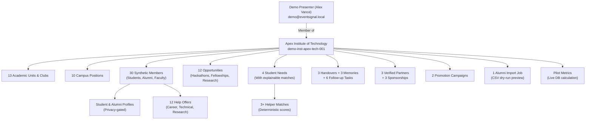

# EventSignal

**Evidence Before You Register. Connections Grounded in Purpose.**

EventSignal is an intelligent professional networking platform connecting students with relevant career and learning opportunities and the alumni and mentors who can help them pursue those opportunities.

Built by **Team NeuroIgniter** for **HackShift — Cmd+Shift+Create 2026** at IIIT Delhi under the theme: **Alumni Network & Professional Connections: Building a Network, Not a Directory**.

> **"AI extracts. Rules evaluate. Evidence explains. Students decide."**

The authoritative product specification is in [`docs/MVP_SPEC.md`](docs/MVP_SPEC.md).
The Demo Mode audit and verification report is in [`docs/DEMO_MODE_AUDIT_REPORT.md`](docs/DEMO_MODE_AUDIT_REPORT.md).
The original Phase 0/1 specification is archived in [`docs/archive/MVP_SPEC_PHASE1.md`](docs/archive/MVP_SPEC_PHASE1.md).

---

## Core Product Workflow

Unlike a static directory of names or events, EventSignal connects opportunities with people through structured intent and explainable evidence:

```
Student Intent
    -> Relevant Opportunities
    -> Relevant Alumni and Mentors
    -> Explainable Recommendations
    -> Purpose-Specific Connection Requests
```

---

## Project Status

This repository has completed **Phase 8 — Partnerships, Cross-College Promotion, Pilot & Release Readiness**.

All 8 phases of the reduced authoritative roadmap are fully implemented, verified, and backed by automated quality gates.

| Phase 1–4: Core Foundation | Phase 5: Workspaces & RBAC | Phase 6: Network & Mentoring | Phase 7: Matching & Legacy | Phase 8: Partnerships & Pilot |
| --- | --- | --- | --- | --- |
| Opportunity ingestion with SSRF protection, generic 3-stage extraction, field-level provenance (`FieldEvidence`), deterministic duplicate detection, and declarative evidence assessment | Multi-college workspaces, tenant isolation, PBKDF2 auth, signed tokens, organizational units, campus positions, and immutable audit logging | Student & alumni profiles, server-side privacy projections, explicit `HelpOffer` lifecycle, and purpose-specific connection requests | Student needs, deterministic Gap-to-Helper matching, honest explanations, campus handovers, event memories, and follow-up commitments | Sponsorship prospectuses, brand partner verification, cross-college promotion with conspicuous disclosure, zero-consent alumni CSV import, and live pilot analytics |
| Ingestion & assessment APIs, evidence cards, conflict detection | Role assignments, workspace switching, audit log security | Consent gates (`willing_to_connect`), category filters | Persisted needs & handovers, deterministic scores | Transparent pricing packages, dry-run import preview, real stored metrics |
| 166 backend tests & 36 frontend tests | Institutional Auth & RBAC UI | 173 backend tests & 43 frontend tests | 209 backend tests & 45 frontend tests | **226 backend tests & 60 frontend tests (ALL PASS)** |

---

## Repository Structure

```text
eventsignal/
├── .env.example             # Safe development defaults; copy to .env (never commit .env)
├── backend/
│   ├── alembic.ini          # Alembic migration configuration
│   ├── migrations/
│   │   ├── env.py           # Migration environment anchoring Base.metadata
│   │   └── versions/        # 0001–0007 migrations (Phases 1–8)
│   ├── app/
│   │   ├── api/             # FastAPI HTTP route modules
│   │   │   ├── health.py    #   GET /api/v1/health
│   │   │   ├── auth.py      #   Registration, login, session & demo endpoints
│   │   │   ├── opportunities.py #  Opportunity intake & assessment
│   │   │   ├── assessment.py #   Evidence assessment API
│   │   │   ├── institutions.py # Colleges, units, positions & memberships
│   │   │   ├── profiles.py  #   Student & alumni profiles, member discovery
│   │   │   ├── help_offers.py # Help offers lifecycle, discovery & requests
│   │   │   ├── phase7.py    #   Student needs, matches, handovers, memories, tasks
│   │   │   ├── phase8.py    #   Sponsorships, campaigns, CSV import, pilot metrics
│   │   │   └── deps.py      #   FastAPI auth & RBAC dependency injection
│   │   ├── core/
│   │   │   ├── config.py    # Typed Settings (pydantic-settings); all env vars declared here
│   │   │   ├── errors.py    # Global error handlers (no leak of internals)
│   │   │   ├── security.py  # PBKDF2 password hashing & signed JWT token auth
│   │   │   └── logging.py   # Structured log configuration
│   │   ├── models/          # SQLAlchemy ORM models (one file per entity)
│   │   │   ├── base.py      #   DeclarativeBase, UTCDateTime, TimestampMixin
│   │   │   ├── user.py      #   Platform User identity
│   │   │   ├── institution.py #  Colleges / institutional workspaces
│   │   │   ├── membership.py #  Multi-tenant RBAC memberships & roles
│   │   │   ├── organizational_unit.py # Departments, cells, and offices
│   │   │   ├── campus_position.py # Official campus positions & tenure
│   │   │   ├── audit_log.py #   Immutable security audit log
│   │   │   ├── opportunity.py # Opportunity entity (scoped to institution_id)
│   │   │   ├── field_evidence.py # Field-level provenance (FOUND/NOT_FOUND/SOURCES_DISAGREE)
│   │   │   ├── source_reference.py # Source URL and attribution
│   │   │   ├── opportunity_assessment.py # Declarative policy assessment
│   │   │   ├── student_profile.py # Institution-scoped StudentProfile
│   │   │   ├── alumni_profile.py  # Institution-scoped AlumniProfile & consent
│   │   │   ├── help_offer.py    # Explicit HelpOffer & lifecycle states
│   │   │   ├── connection_request.py # Purpose-specific connection requests
│   │   │   ├── student_need.py  # Phase 7: Declared student challenges
│   │   │   ├── helper_match.py  # Phase 7: Persisted helper matches
│   │   │   ├── match_explanation.py # Phase 7: Deterministic score rationales
│   │   │   ├── legacy_handover.py # Phase 7: Leadership transition handovers
│   │   │   ├── event_memory.py  # Phase 7: Institutional event retrospectives
│   │   │   ├── follow_up_task.py # Phase 7: Post-event follow-up commitments
│   │   │   ├── sponsorship.py   # Phase 8: Partner orgs & sponsorship prospectuses
│   │   │   ├── promotion_campaign.py # Phase 8: Cross-college campaigns
│   │   │   └── alumni_import.py # Phase 8: Batch alumni directory import jobs
│   │   ├── services/        # Business & security services
│   │   │   ├── auth.py      #   User lifecycle & token management
│   │   │   ├── institution.py #  Multi-tenant workspace operations
│   │   │   ├── profile.py   #   Profile CRUD, active gate, privacy projection
│   │   │   ├── help_offer.py #  Offer lifecycle, discovery & requests
│   │   │   ├── matching.py  #   Phase 7: Deterministic matching engine
│   │   │   ├── legacy.py    #   Phase 7: Handovers, memories & tasks
│   │   │   ├── sponsorship.py # Phase 8: Sponsorship lifecycle & commercial terms
│   │   │   ├── promotion.py #   Phase 8: Campaign review & cross-college feed
│   │   │   ├── alumni_import.py # Phase 8: Dry-run CSV parser & zero-consent import
│   │   │   ├── pilot_metrics.py # Phase 8: Operational indicators aggregator
│   │   │   ├── audit.py     #   Security event logging
│   │   │   └── demo_service.py # Demo environment provisioning & idempotent seeding
│   │   ├── schemas/         # Pydantic v2 API contracts (request/response)
│   │   ├── database.py      # Engine, session factory, init_db, health checks
│   │   ├── main.py          # Application factory & lifespan (includes demo seeding)
│   │   └── __main__.py      # `python -m app` entry point (uvicorn)
│   ├── tests/               # Pytest suite (226 tests, isolated in-memory DBs)
│   │   ├── conftest.py      #   Shared fixtures (isolated DB, demo settings)
│   │   ├── test_demo.py     #   12 demo integration tests (community, isolation, idempotency)
│   │   └── test_*.py        #   Per-module unit & integration tests
│   ├── requirements.txt     # Runtime Python dependencies (pinned)
│   ├── requirements-dev.txt # Dev/test extras (pytest, ruff, mypy, etc.)
│   └── pyproject.toml       # Ruff and Mypy strict configuration
├── frontend/
│   ├── src/
│   │   ├── components/      # Presentational UI components
│   │   │   ├── AuthLandingPage.tsx # 3-tab auth: Normal, Guest, Demo Mode
│   │   │   ├── AuthModal.tsx       # In-app authentication modal
│   │   │   ├── Avatar.tsx          # SVG identicon & initial-based avatars (HSL palette)
│   │   │   ├── ErrorBoundary.tsx   # React error boundary with recovery action
│   │   │   ├── AppNavbar.tsx       # Top navigation bar & active tab highlighting
│   │   │   ├── Header.tsx          # App header with demo banner & user controls
│   │   │   ├── MyProfileModal.tsx  # Student & alumni profile editor
│   │   │   ├── MemberDiscoveryPanel.tsx # Campus network member discovery
│   │   │   ├── HelpOffersPanel.tsx # Campus mentorship & help offer manager
│   │   │   ├── InstitutionWorkspacePanel.tsx # College workspace manager
│   │   │   ├── LegacyMatchingPanel.tsx # Phase 7: Needs, matching & legacy handovers
│   │   │   ├── PartnershipsPromotionPanel.tsx # Phase 8: Sponsorships, campaigns, CSV, metrics
│   │   │   ├── OpportunityFeed.tsx # Main opportunity discovery feed
│   │   │   ├── AssessmentPanel.tsx # Opportunity assessment viewer
│   │   │   ├── OpportunityIntakeForm.tsx # URL ingest & evidence review
│   │   │   ├── DiscoveryPanels.tsx # Right-column discovery widgets
│   │   │   ├── ProfileSidebar.tsx  # Left-column user profile & stats
│   │   │   └── WelcomePanel.tsx    # Guest & demo welcome state
│   │   ├── hooks/           # Custom React hooks (useRemoteResource: loading, error, retry)
│   │   ├── services/        # Typed API client modules
│   │   ├── types/           # TypeScript interfaces for all API entities
│   │   ├── App.tsx          # Application shell & 8-tab navigation with ErrorBoundary
│   │   └── main.tsx         # React entry point
│   ├── package.json
│   ├── tsconfig.json        # Strict TypeScript settings
│   └── vite.config.ts       # Vite build & dev proxy configuration
├── scripts/
│   ├── verify.py            # Runs all quality gates in order (pytest → vitest → tsc → build)
│   └── integration_test.py  # Live end-to-end integration check against running server
├── docs/
│   ├── MVP_SPEC.md          # Authoritative product specification (Phases 1–8)
│   ├── DEMO_MODE_AUDIT_REPORT.md # End-to-end demo audit, defect resolutions, verification
│   ├── FINAL_AUDIT_REPORT.md     # Phase 8 completion audit
│   ├── PHASE1_REPORT.md     # Phase 1 completion report
│   ├── PHASE4_REPORT.md     # Phase 4 completion report
│   └── archive/             # Archived original Phase 0/1 specification
└── data/                    # Local SQLite database file (git-ignored)
```

---

## Getting Started

### Prerequisites

- Python 3.11+
- Node.js 18+ & npm

### Backend Setup

```bash
cd backend

# Create a virtual environment
python -m venv .venv

# Install runtime + dev dependencies
# Windows:
.venv\Scripts\pip install -r requirements-dev.txt
# macOS/Linux:
.venv/bin/pip install -r requirements-dev.txt

# Copy and configure the root environment file
# Windows PowerShell:
Copy-Item .env.example .env
# macOS/Linux:
cp .env.example .env

# (Optional) Run schema migrations explicitly.
# The app also runs `create_all` automatically on first startup.
# Windows:
.venv\Scripts\alembic upgrade head
# macOS/Linux:
.venv/bin/alembic upgrade head
```

### Running the Backend

```bash
cd backend

# Windows:
.venv\Scripts\python -m app
# macOS/Linux:
.venv/bin/python -m app

# Serves at http://127.0.0.1:8000
# Interactive API docs: http://127.0.0.1:8000/docs
```

### Frontend Setup & Run

```bash
cd frontend
npm ci
npm run dev
# Serves at http://localhost:5173
```

---

## Access Experiences & Demo Mode

EventSignal supports three distinct access experiences, enforced by the backend at both the authentication layer and every institutional route dependency:

### 1. Normal User Mode

Authenticated users who register or sign in with personal credentials. Access is strictly scoped to the real institutional workspaces they belong to. Normal users cannot see demo records.

### 2. Guest Mode

Unauthenticated visitors who select **"Continue as Guest"** or **"Skip for Now"** on the landing page. Guests can browse publicly listed opportunities but cannot access institutional endpoints. Clicking any feature guarded by `require_institution_membership` returns HTTP 401/403. **Guest Mode never activates Demo Mode or exposes any demo data.**

### 3. Demo Mode

A dedicated sign-in experience for presenters and evaluators. Demo users authenticate with separate credentials, receive a standard JWT token that includes `is_demo: true`, and gain scoped access to the **Apex Institute of Technology** demo workspace (`demo-inst-apex-tech-001`). All demo data is synthetic, isolated, and strictly prevented from appearing in any normal tenant's views.

---

## Dedicated Demo Mode Configuration

### Environment Variables

Configure demo mode in the root `.env` file (copied from `.env.example`):

```env
# Enable or disable the presentation demo environment
DEMO_MODE_ENABLED=true

# Dedicated demo presenter credentials — never use production secrets here
DEMO_USER_EMAIL=demo@eventsignal.local
DEMO_USER_PASSWORD=<set a strong password in your local .env>
```

> [!IMPORTANT]
> - `DEMO_USER_PASSWORD` must be set in your local `.env`. The placeholder default in `.env.example` must never be published or committed.
> - When `DEMO_MODE_ENABLED=false`, the Demo tab is hidden on the landing page, demo login attempts return `403 Forbidden`, and demo seeding/reset endpoints are disabled.
> - Demo credentials are **never** hardcoded in frontend source files or bundled into client JavaScript.
> - The demo user has `is_demo: true` and is strictly scoped to the demonstration workspace.

### Automatic Provisioning on Startup

When `DEMO_MODE_ENABLED=true`, the backend `lifespan` event handler in `main.py` automatically provisions the demo user and idempotently seeds all demonstration data on application startup. No manual seeding step is required.

### On-Demand Seeding & Reset API

| Endpoint | Method | Purpose |
| --- | --- | --- |
| `/api/v1/auth/demo/status` | `GET` | Returns `{"enabled": true, "seeded": true}` |
| `/api/v1/auth/demo/seed` | `POST` | Idempotently seeds all 8 module data sets |
| `/api/v1/auth/demo/reset` | `POST` | Safely removes all demo records without touching production data |

---

## Synthetic College Community (Apex Institute of Technology)

The demo workspace is populated with a realistic, fully interconnected college community. All records are seeded from `backend/app/services/demo_service.py` and stored in the application database via the standard ORM models.

| Category | Count | Description |
| --- | --- | --- |
| **Academic Units & Clubs** | 13 | CSE Dept, AI/DS Dept, ECE Dept, Design Dept, Management Dept, ACM Student Chapter, Robotics Club, Photography Society, Entrepreneurship Cell, Research Cell, Cultural Committee, Sports Council, Alumni Relations Cell |
| **Campus Positions** | 10 | Club Presidents, Vice-Presidents, Secretary roles with institutional appointments |
| **Community Members** | 30 | Students across all years, student leaders, alumni mentors, faculty advisors — all with profiles, tags, and help offers |
| **Opportunities** | 12 | Hackathons, fellowships, internships, research calls with field-level evidence and assessments |
| **Help Offers** | 12 | Peer & alumni mentorship offers across career, technical, and research tracks |
| **Student Needs** | 4 | Declared student challenges with explainable rule-derived helper matches |
| **Helper Matches** | 3+ | Deterministic compatibility-scored matches with per-field explanation breakdown |
| **Legacy Handovers** | 3 | Leadership transition handovers from outgoing to incoming club officers |
| **Event Memories** | 3 | Institutional retrospective memories (annual tech symposium, hackathon lessons, etc.) |
| **Follow-up Tasks** | 6 | Post-event commitments with priority and status tracking |
| **Partners** | 3 | Verified corporate partner organizations |
| **Sponsorships** | 3 | Tiered sponsorship requests (under review, accepted) |
| **Promotion Campaigns** | 2 | Cross-college campaigns with active/sponsored status |
| **Alumni Import Jobs** | 1 | Committed alumni directory CSV import with dry-run preview |

### Demo Data Relationships



### Isolation Guarantees

- All demo records carry `institution_id = "demo-inst-apex-tech-001"` and `extra_data["is_demo"] = true`.
- Opportunity public feeds and all multi-tenant queries are scoped by user membership, preventing synthetic records from appearing in real tenant views.
- Seeding is **deterministic and idempotent** — repeating the seed operation updates existing records rather than creating duplicates.
- Resetting demo data deletes only records with `institution_id = "demo-inst-apex-tech-001"`.

---

## Authentication Flow

```
POST /api/v1/auth/login
   body: { email, password }
   -> 200 OK: { access_token, token_type, user: { id, email, is_demo, ... } }
   -> 401 Unauthorized: invalid credentials
   -> 403 Forbidden: demo login attempted when DEMO_MODE_ENABLED=false

GET /api/v1/auth/me   (Authorization: Bearer <token>)
   -> 200 OK: current user claims
   -> 401 Unauthorized: token invalid or expired
```

The frontend stores the bearer token in `localStorage`. On every page load, `GET /api/v1/auth/me` is called to restore session state. Sign-out clears the token and resets React state to the landing page.

---

## API Overview

All routes are mounted under `/api/v1`. An interactive Swagger UI is available at `http://127.0.0.1:8000/docs` when the backend is running.

| Route Group | Prefix | Description |
| --- | --- | --- |
| Health | `/health` | Service health, DB connectivity, version |
| Auth | `/auth` | Login, register, session, demo endpoints |
| Opportunities | `/opportunities` | Intake, extraction, deduplication, discovery |
| Assessment | `/assessment` | Policy-driven evidence scoring |
| Institutions | `/institutions` | Colleges, units, positions, memberships |
| Profiles | `/profiles` | Student & alumni profiles, member discovery |
| Help Offers | `/help-offers` | Offer lifecycle, discovery, requests |
| Phase 7 | `/phase7` | Needs, matching, handovers, memories, tasks |
| Phase 8 | `/phase8` | Sponsorships, campaigns, CSV import, metrics |

---

## Database & Migrations

The application uses **SQLite** by default (suitable for local development and evaluation). The database schema is managed by **Alembic** with 7 migration files covering all 8 phases:

| Migration | Coverage |
| --- | --- |
| `0001_phase2_domain_foundation` | Core entities: users, institutions, memberships, opportunities, field evidence, source references |
| `0002_phase4_opportunity_assessments` | Opportunity assessment tables |
| `0003_phase4_policy_and_conflicts` | Assessment policy and source conflict tables |
| `0004_phase5_institutional_identity_and_access` | Organizational units, campus positions, assignments, audit log |
| `0005_phase6_profiles_and_help_offers` | Student profiles, alumni profiles, help offers, connection requests |
| `0006_phase7_matching_and_legacy` | Student needs, helper matches, explanations, legacy handovers, event memories, follow-up tasks |
| `0007_phase8_partnerships_promotion_pilot` | Partner organizations, sponsorship requests, promotion campaigns, alumni import jobs |

For production deployments using PostgreSQL or another database, set `DATABASE_URL` in `.env` to the appropriate SQLAlchemy connection string. Alembic migrations are backend-agnostic.

---

## Verification & Quality Gates

Run the full automated quality verification suite from the repository root:

```bash
# Windows:
backend\.venv\Scripts\python scripts\verify.py

# macOS/Linux:
backend/.venv/bin/python scripts/verify.py
```

Or run individual test suites:

```bash
# Backend pytest suite (226 tests including 12 dedicated demo integration tests)
cd backend
# Windows:
.venv\Scripts\pytest
# macOS/Linux:
.venv/bin/pytest

# Frontend vitest suite (60 tests across 12 test files)
cd frontend
npm test -- --run

# Frontend strict TypeScript type check
cd frontend
npx tsc --noEmit

# Frontend production build (validates bundling and tree-shaking)
cd frontend
npm run build
```

### Latest Verified Results

| Suite | Result | Count |
| --- | --- | --- |
| Backend Pytest | ✅ All Pass | 226 tests across 19 test files |
| Frontend Vitest | ✅ All Pass | 60 tests across 12 test files |
| TypeScript (`tsc --noEmit`) | ✅ 0 errors | — |
| Vite production build | ✅ 0 errors | dist: ~501 kB JS, ~55 kB CSS |

---

## Demo Reset Procedure

To restore all demo records to their pristine initial state without affecting other data:

```bash
# Via the API (backend must be running):
curl -X POST http://127.0.0.1:8000/api/v1/auth/demo/reset
curl -X POST http://127.0.0.1:8000/api/v1/auth/demo/seed

# Or restart the backend — automatic seeding runs on every startup.
```

The seeding operation uses fixed UUIDs and SQLAlchemy `merge()` semantics, so it is safe to run repeatedly without creating duplicate records.

---

## Security & Privacy Principles

1. **Passwords** hashed with PBKDF2-HMAC-SHA256; never stored in plaintext.
2. **JWT tokens** are signed with a configurable secret key (`AUTH_SECRET_KEY`). Tokens expire after `AUTH_TOKEN_EXPIRE_MINUTES` (default 1440 minutes / 24 hours).
3. **Tenant isolation** enforced at every institutional route dependency (`require_institution_membership`). Demo users cannot modify real institutional records; normal users cannot read demo records.
4. **No secrets in client code**: `VITE_*` environment variables are public; sensitive values (`AUTH_SECRET_KEY`, `DEMO_USER_PASSWORD`) live only in the backend's `.env`.
5. **SSRF protection** on all opportunity URL ingestion: private IP ranges blocked, redirect chains validated, content-length limited, and only allow-listed content types accepted.
6. **Privacy by default**: Student profiles default to `PRIVATE` visibility. Alumni profiles require explicit `willing_to_connect = true` before connection requests can be routed to them.
7. **Honest uncertainty**: Missing data is represented as `NOT_FOUND`, conflicting sources as `SOURCES_DISAGREE`, and extraction failures as `EXTRACTION_FAILED` — never disguised as null or fabricated values.

---

## Known Limitations (Local Development)

- The development server is bound to `http://localhost:5173` (frontend) and `http://127.0.0.1:8000` (backend). For remote evaluator access, deploy to Cloud Run or a staging environment.
- Outbound email notifications and external payment processing integrations are graceful stubs in demo mode; no SMTP messages are dispatched.
- External partner logos are served as synthetic placeholder assets; real CDN integration is deferred post-pilot.
